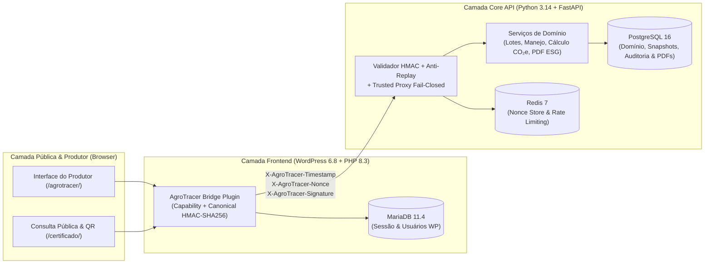

<div align="center">

# 🌱 AgroTracer

**Plataforma de Rastreabilidade Pecuária Declarada e Estimativa Versionada de Pegada de Carbono (CO₂e) com Certificação Auditável e Consulta Pública via QR Code**

[](https://github.com/GrupoWinners/AgroTracer/actions/workflows/ci.yml)
[](https://github.com/GrupoWinners/AgroTracer/releases/tag/v1.0.0)
[-1f7a4c)](docs/evidencias/sprint-7/S7-T03.md)
[](docs/evidencias/sprint-7/ci-verificada.json)
[](docs/adr/0002-autenticacao-bridge-hmac.md)
[](backend/Dockerfile)
[](backend/requirements.txt)
[](wordpress/agrotracer-bridge/agrotracer-bridge.php)
[](ops/demo/compose.yaml)
[](ops/demo/compose.yaml)

</div>

---

## 📋 Visão Geral

O **AgroTracer** é uma solução integrada de engenharia de software para rastreabilidade pecuária por lote, registro temporal de manejo nutricional, cálculo determinístico de emissões de gases de efeito estufa (**CO₂e**) com conjuntos de fatores versionados, fechamento imutável (*snapshot*) e emissão de **Certificado ESG Timbrado em PDF** com verificação pública via **Token Opaco e QR Code**.

> **Aviso de Proveniência (`SYNTHETIC`):** Os fatores de emissão e dados de demonstração utilizados no MVP são estritamente **didáticos (`SYNTHETIC`)** para validação arquitetural, acadêmica e funcional. Não constituem inventário oficial de emissões, validação científica nem certificação ambiental independente.

---

## 🏗️ Arquitetura e Segurança



### Pilares Arquiteturais
- **Autenticação Server-to-Server HMAC-SHA256 ([ADR-002](docs/adr/0002-autenticacao-bridge-hmac.md)):** Nenhuma chave secreta ou chamada direta à API FastAPI é exposta ao navegador. O plugin WordPress (`agrotracer-bridge`) assina cada requisição com string canônica (`METHOD`, `PATH`, `QUERY`, `TIMESTAMP`, `NONCE`, `USER_ID`, `BODY_SHA256`).
- **Proteção Anti-Replay e Rate Limiting:** O backend FastAPI valida janela temporal estrita e registra nonces únicos no **Redis 7**, além de impor rate limiting por IP real validado na consulta pública.
- **Integridade Temporal e Imutabilidade no Banco:** O **PostgreSQL 16** utiliza a extensão `btree_gist` para impedir sobreposição de períodos de manejo nutricional no mesmo lote, além de triggers que bloqueiam mutação ou exclusão de snapshots, certificados, auditoria e conjuntos de parâmetros publicados.
- **Rastreabilidade Criptográfica Ponta a Ponta:** Cada fechamento gera um `snapshot_sha256` determinístico; o PDF timbrado ESG é persistido com `pdf_sha256` verificável e um token público opaco exibido uma única vez (armazenado apenas como `token_hash` SHA-256).

---

## 🛠️ Stack Tecnológica

| Camada | Tecnologia | Versão Declarada | Responsabilidade |
| :--- | :--- | :--- | :--- |
| **Core Backend** | Python + FastAPI + Pydantic v2 | Python `3.14.7` / FastAPI `0.135` | Regras de negócio, cálculo determinístico de CO₂e, geração de PDF ReportLab e segurança HMAC |
| **Persistência Core** | PostgreSQL + SQLAlchemy 2 + Alembic | PostgreSQL `16-alpine` | Persistência relacional, constraints `btree_gist`, triggers de imutabilidade e binários PDF |
| **Segurança & Cache** | Redis | Redis `7-alpine` | Armazenamento de nonces anti-replay com TTL e contadores de rate limiting público |
| **Frontend & BFF** | WordPress + PHP + JS/CSS Vanilla | WP `6.8.3` / PHP `8.3-apache` | Portal do produtor, controle de capability (`agrotracer_manage_farms`), cliente HTTP HMAC e consulta pública |
| **Banco Frontend** | MariaDB | MariaDB `11.4` | Persistência isolada do WordPress |
| **Qualidade & CI/CD** | GitHub Actions + Pytest + Flake8 + PHP CLI | 5 Jobs Automatizados | Testes de unidade/integração, migrations, lint, drill de backup/restore, demo limpa e pacote SHA-256 |

---

## 🚀 Do Clone à Demo Local (Bootstrap Reproduzível)

### Pré-requisitos
- **Git** e **Python 3.12+** (CI executa em `3.14.7`)
- **Docker** com containers Linux e **Docker Compose v2** (`up --wait`)
- Portas locais `18000` (FastAPI) e `18080` (WordPress) livres

### Passo a Passo Rápido
Os comandos abaixo funcionam igualmente em **PowerShell**, **Git Bash** e **Linux**:

```sh
git clone https://github.com/GrupoWinners/AgroTracer.git
cd AgroTracer
python tools/demo.py up
python tools/demo.py verify
```

### O que o bootstrap (`tools/demo.py up`) executa automaticamente?
1. Gera credenciais e segredo HMAC aleatórios exclusivos da máquina local em `.demo/` (diretório ignorado pelo Git).
2. Sobe a topologia isolada (`ops/demo/compose.yaml`) e executa `alembic upgrade head`.
3. Instala e configura o WordPress, ativa o plugin `agrotracer-bridge`, cria as páginas `/agrotracer/` e `/certificado/` e atribui a capability `agrotracer_manage_farms` ao usuário produtor.
4. Executa o seed sintético idempotente (`backend/app/demo_seed.py`), provisionando:
   - **Fazenda:** `Fazenda SYNTHETIC S7` (com talhão `DEMO-PASTO`), 2 animais e 2 lotes com histórico de manejo.
   - **Conjunto de Fatores Ativo:** `S7-DEMO-SYNTHETIC-1`.
   - **Lote `S7-DEMO-CERTIFICADO`:** já fechado, com snapshot, certificado, token público e PDF persistidos.
   - **Lote `S7-DEMO-PARA-EMITIR`:** pronto para demonstração ao vivo do fechamento e emissão de certificado.

### Acessando o Ambiente Local
- **Portal do Produtor:** `http://127.0.0.1:18080/agrotracer/` *(usuário e senha disponíveis em `.demo/acesso.json`)*
- **Consulta Pública de Certificado:** `http://127.0.0.1:18080/certificado/` *(token do lote pré-certificado disponível em `.demo/acesso.json`)*
- **Healthcheck da API:** `http://127.0.0.1:18000/health`

Para demonstrar a emissão do segundo lote (`S7-DEMO-PARA-EMITIR`), informe na tela de **Fechamento**:
- **Data do abate:** `2026-02-02` | **Animais abatidos:** `1` | **Peso médio:** `540` kg | **Rendimento de carcaça:** `0.53`

Para encerrar os containers preservando os volumes e dados:
```sh
python tools/demo.py stop
```

> **Segurança do ambiente local:** Nunca compartilhe nem versione a pasta `.demo/`, `.demo/acesso.json` ou `.demo/.env`. Se `.demo/acesso.json` for perdido, o token original do primeiro certificado não pode ser reconstituído em texto claro a partir do banco.

---

## 🧪 Desenvolvimento, Qualidade e Testes

### Executando a Suíte Backend (Python / FastAPI)
```sh
cd backend
python -m venv .venv
# PowerShell: .venv\Scripts\Activate.ps1 | Linux/Git Bash: source .venv/bin/activate
python -m pip install -r requirements-dev.txt
python -m flake8 app tests ../tools/demo.py ../tools/release_check.py ../tools/release_bundle.py
python -m pytest -v -k "not test_s1_t01_postgresql"
```

### Executando a Suíte Frontend/Bridge (PHP)
```sh
# Validação de sintaxe e testes de regressão da Bridge WordPress
for test in wordpress/agrotracer-bridge/tests/test-*.php; do php "$test"; done
```

### Pipeline de Verificação Contínua (GitHub Actions)
O workflow [`.github/workflows/ci.yml`](.github/workflows/ci.yml) executa **5 jobs** automatizados:
1. **`verificacoes`**: `alembic upgrade head` em PostgreSQL 16 real, `flake8` estrito, `pytest` (341+ testes) com Redis 7 real e coleta de métricas sintéticas de performance.
2. **`recuperacao`**: Simulação completa de desastre (Backup & Restore Drill de PostgreSQL, MariaDB e `wp-content`) validando integridade de `pdf_sha256` e RTO em laboratório isolado.
3. **`demo_limpa`**: Execução ponta a ponta de `tools/demo.py up` (duas vezes para provar idempotência), `tools/release_check.py` e `tools/demo.py verify`.
4. **`wordpress_release`**: Lint (`php -l`) em todos os arquivos PHP e execução integral das suítes `wordpress/agrotracer-bridge/tests/test-*.php`.
5. **`pacote_candidato`**: Empacotamento determinístico via `tools/release_bundle.py` com manifesto e verificação `sha256sum -c SHA256SUMS.txt`.

---

## 📂 Estrutura do Repositório

```text
AgroTracer/
├── .github/workflows/ci.yml         # Pipeline CI/CD com 5 jobs de verificação e release
├── backend/
│   ├── app/
│   │   ├── api/v1/                  # Endpoints REST (fazendas, lotes, animais, manejos, fechamentos, certificados)
│   │   ├── assets/                  # Brasão e marca d'água do Certificado PDF Timbrado ESG
│   │   ├── core/                    # Protocolo HMAC-SHA256, anti-replay Redis, rate limit e logs seguros
│   │   ├── domain/                  # Máquina de estados do lote e regras de domínio
│   │   ├── models/                  # Modelos SQLAlchemy 2.0
│   │   ├── schemas/                 # Contratos Pydantic v2
│   │   └── services/                # Motor de cálculo CO₂e, snapshots, geração PDF e consulta pública
│   ├── migrations/                  # Migrations Alembic (PostgreSQL + btree_gist + triggers de imutabilidade)
│   └── tests/                       # Suítes automatizadas de unidade, integração, segurança, UAT e performance
├── wordpress/
│   └── agrotracer-bridge/           # Plugin oficial WordPress (Cliente HTTP HMAC, REST BFF, Templates e Testes PHP)
├── ops/demo/                        # Docker Compose e configurações endurecidas (Apache/PHP safe logs)
├── tools/                           # Orquestradores CLI: demo.py, release_check.py e release_bundle.py
└── docs/
    ├── adr/                         # Architecture Decision Records (ADR-002 HMAC Bridge)
    ├── evidencias/                  # Pacotes auditáveis de QA e entregas das Sprints 0 a 7
    ├── operacao/                    # Manual do usuário, backup/restore, logs seguros e checklist de release
    └── releases/                    # Notas oficiais de lançamento (v1.0.0)
```

---

## 📚 Documentação Operacional e Evidências de Auditoria

- 📖 **[Manual do Usuário (Fluxo Ponta a Ponta)](docs/operacao/manual-usuario.md)**
- 📦 **[Notas da Release v1.0.0](docs/releases/v1.0.0.md)**
- ✅ **[Matriz Final de QA, UAT e Bugs Conhecidos (S7-T03)](docs/evidencias/sprint-7/S7-T03.md)**
- 🔒 **[Checklist e Gate de Segurança de Release (S7-T05)](docs/operacao/release-checklist.md)**
- 🛡️ **[Política de Logs Seguros e Privacidade](docs/operacao/logs-seguros.md)**
- 💾 **[Procedimento de Backup e Recuperação (Restore Drill)](docs/operacao/backup-restore.md)**
- 🏷️ **[Guia de Custódia e Publicação de Release (S7-T06)](docs/operacao/publicar-release.md)**

---

## 👥 Equipe Responsável (Grupo Winners)

| Integrante | Papel e Escopo Principal |
| :--- | :--- |
| **João Vitor Santos de Souza (Losel)** | Arquitetura WordPress Bridge, Cliente HTTP HMAC, Interface UX/UI, Certificado PDF ESG e Integração |
| **Samela Maria** | Core Backend FastAPI, Modelagem PostgreSQL/Alembic, Segurança/Proxy, Automação Docker/CI e Empacotamento |
| **Nadiny Martins** | Engenharia de Qualidade (QA Gate), Catálogo BDD, Testes de Hardening/Limites e Homologação UAT |
